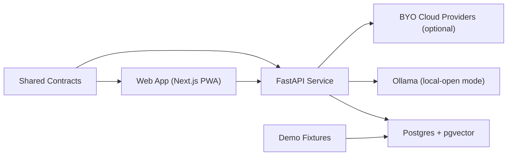

# OwnerPilot

**AI operating copilot for smaller business owners**

OwnerPilot is an open-source decision intelligence platform for SMB owners. It helps small businesses import historical records, track recurring obligations, investigate margin and cash shifts, and execute evidence-backed actions.

The first public product story is an India-first pharmacy and medical-store demo, while the domain model remains reusable for other SMB segments.

This repository is the current public implementation of a longer-running project concept and continues to evolve through visible milestones.

## Jump to
- [Why this project exists](#why-this-project-exists)
- [What is implemented now](#what-is-implemented-now)
- [Quickstart](#quickstart-local-development)
- [Recruiter and interview proof](#recruiter-and-interview-proof)
- [Project timeline](#project-timeline)
- [Product direction](docs/product-direction.md)
- [Repository layout](#repository-layout)
- [Engineering quality bar](#engineering-quality-bar)

## Why this project exists
Large companies make daily decisions using analytics teams and expensive tooling. Most SMB owners do not have that support.

OwnerPilot focuses on closing that gap with:
- practical owner workflows over generic dashboards
- local/open model support by default for low-cost adoption
- explainable recommendations with evidence and confidence traces

## What is implemented now
### Coverage-aware procurement planning (Phase 3.2)

Versioned local research now tracks required source reads separately from citations,
uses closed batches of up to four approved lines, and supports bounded research of
up to twelve lines. Native model choices and backend mandatory completion have
separate durable attribution. Citation-only verification, exact source associations,
human quote approvals and historical protocols remain preserved.

Validation: 473 backend passes plus the retained strict xfail; 21 browser scenarios
passed. The preselected hybrid completed 52/60 held-out RFQs (86.7%) with 324/324
source-covered lines. Coverage-aware native planning completed 56/60 (93.3%); the
target was 57/60. All 240 held-out executions had zero independently detected
unsupported accepted facts or unauthorized successful tools. **Functionally validated —
research-quality target unmet**. Complete source reads can still end with incomplete
model-selected citations. Actual worker recovery preserved receipts and completed
remaining reads, then safely required attention after citation correction exhausted.

- [Phase 3.2 final report](docs/rfq/phase3_2/FINAL_IMPLEMENTATION_REPORT.md)
- [Evaluation, failures and timing limitations](docs/rfq/phase3_2/EVALUATION_RESULTS.md)
- [Phase 3.2 status](docs/rfq/phase3_2/STATUS.md)
- [Architecture and attribution](docs/rfq/phase3_2/ARCHITECTURE.md) · [Budget policy](docs/rfq/phase3_2/BUDGET_POLICY.md)
- [Independent evaluation methodology](docs/rfq/phase3_2/EVALUATION_METHODOLOGY.md)
- [Windows setup](docs/rfq/phase3_2/WINDOWS_SETUP.md) · [Demo](docs/rfq/phase3_2/DEMO_RUNBOOK.md)

### Citation-only procurement research (Phase 3.1)

Local research selects source references while the backend materializes exact
commercial values with line/product/offer provenance, explicit unknowns, independent
coverage, safe partial evidence and one durable citation correction. Historical
protocols and financial calculations remain preserved.

Validation: 386 backend passes plus the original strict oracle xfail; fifteen browser
scenarios passed. On the new frozen 60-case benchmark, verified completion was
36/60, including 20/36 held-out (55.6%), with zero accepted unsupported facts.
The separate original ten-case comparison completed 10/10. **Functionally validated —
research-quality target unmet**: planning still omits required source reads.

- [Phase 3.1 final report](docs/rfq/phase3_1/FINAL_IMPLEMENTATION_REPORT.md)
- [Independent evaluation and failures](docs/rfq/phase3_1/EVALUATION_RESULTS.md)
- [Validation](docs/rfq/phase3_1/PHASE3_1_VALIDATION.md) · [Windows setup](docs/rfq/phase3_1/WINDOWS_SETUP.md) · [Demo](docs/rfq/phase3_1/DEMO_RUNBOOK.md)

### Procurement research and internal quotes (Phase 3)

Approved RFQs now support explicit reviewed product resolutions, versioned supplier
attestations, real local Ollama tool-using research, durable evidence receipts, and
Decimal quote preparation with human review and immutable internal approval.
Exact/BM25/SQL retrieval remains usable without an embedding service.

Local validation: 260 backend tests passed with one retained expected-label defect;
30/30 native tool calls executed, while 6/10 research summaries passed verification.
The 95% research-completion aspiration remains unmet. No quote delivery, purchasing
or payment action is enabled.

- [Phase 3 report and measured limitations](docs/rfq/phase3/FINAL_IMPLEMENTATION_REPORT.md)
- [Validation and evaluation](docs/rfq/phase3/PHASE3_VALIDATION.md)
- [Windows setup](docs/rfq/phase3/WINDOWS_SETUP.md) · [Demo runbook](docs/rfq/phase3/DEMO_RUNBOOK.md)

### Catalog Intelligence (Phase 2)

Approved RFQ lines can be matched to versioned catalogs using exact manufacturer/MPN,
genuine BM25, local learned embeddings in pgvector, rank fusion and conservative
specification checks. Imports require preview/confirmation; product decisions retain
catalog/query provenance and audit history. Synthetic validation:145 backend tests,
seven browser scenarios,1,020 vectors and816 query/method evaluations. Real-world
compatibility and production hardening remain open.

- [Phase 2 report and measured limits](docs/rfq/phase2/FINAL_IMPLEMENTATION_REPORT.md)
- [Retrieval results](docs/rfq/phase2/EVALUATION_RESULTS.md)
- [Windows setup and demonstration](docs/rfq/phase2/WINDOWS_SETUP.md)

### Procurement extraction hardening (Phase 1.1)

Versioned selective RFQ routing, bounded OCR geometry/preprocessing, stronger source
associations, local 4B/8B/27B model experiments and an independent frozen synthetic
dataset are implemented. All 103 backend tests and six browser scenarios pass;
192 final document/configuration evaluations completed. Extraction quality targets
remain unmet, especially scanned identifiers and selective model repair.

- [Phase 1.1 measured report and limitations](docs/rfq/phase1_1/FINAL_IMPLEMENTATION_REPORT.md)
- [Evaluation results and exact counts](docs/rfq/phase1_1/EVALUATION_RESULTS.md)
- [Windows setup, isolated demo and reproduction commands](docs/rfq/phase1_1/WINDOWS_SETUP.md)
- [Validation and preservation evidence](docs/rfq/phase1_1/PHASE1_1_VALIDATION.md)

### Procurement and RFQ Intelligence (Phase 1)

An isolated local RFQ workflow now supports authenticated workspace requests, secure
PDF/CSV/XLSX/TXT uploads, Linux OCR workers, real Ollama structured extraction,
source evidence, corrections and explicit auditable approval. Processing is durable
and retry-safe with PostgreSQL, Redis and Celery. Existing showcase analytics remain
deterministic; the new module makes actual local model HTTP calls.

- [RFQ setup and Windows commands](docs/rfq/WINDOWS_SETUP.md)
- [Synthetic demonstration](docs/rfq/DEMO_RUNBOOK.md)
- [Validation, measured quality and limitations](docs/rfq/PHASE1_VALIDATION.md)
- [Current phase status](docs/rfq/STATUS.md)

Current showcase scope (`v1.0.0-showcase`) includes:

### Owner operations
- import preview and confirmation for CSV/Excel business records
- recurring obligations tracking with operational status updates
- daily quick-add entries for sales, purchases, and expenses
- action queue with lifecycle states (`open`, `watching`, `snoozed`, `resolved`)
- cash-aware reorder planning that blends product stock, sales velocity, supplier costs, expiry risk, and obligations

### AI analyst workflows
- investigation flow with prompt guardrails and structured output
- retrieval-backed evidence snippets from stored business documents
- provider modes: `local-open`, `byo-cloud`, `hybrid`
- model metadata surfaced in responses (provider, mode, latency, estimated cost)

### Forecasting and planning
- deterministic baseline forecasting for core metrics
- scenario planner for owner-facing what-if analysis
- scheduler trigger path for brief/anomaly/reminder generation
- dedicated Reorder Plan workspace for replenishment decisions

### Delivery modes
- hosted demo-friendly deployment path
- full self-hosted Docker Compose stack with Ollama
- installable PWA UX targeting Android and Windows browsers

## Architecture at a glance

Detailed architecture notes: [docs/architecture.md](docs/architecture.md)

## Quickstart (local development)
1. Install dependencies:
   - `pnpm install`
   - `uv sync --project apps/api`
2. Copy `.env.example` to `apps/web/.env.local`.
3. Start local services:
   - `pnpm docker:up`
4. Apply auth and app schema:
   - `pnpm --filter @ownerpilot/web auth:migrate`
   - `pnpm db:migrate`
5. Seed or reset demo data:
   - `pnpm demo:seed`
   - `pnpm demo:reset`
6. Run apps:
   - `pnpm web:dev`
   - `pnpm api:dev`

PostgreSQL runs on `localhost:5433` in local mode to reduce conflicts with other stacks.

## Recruiter and interview proof
- Architecture and boundaries: [docs/architecture.md](docs/architecture.md)
- Deployment paths: [docs/deployment.md](docs/deployment.md)
- Demo runbook: [docs/showcase.md](docs/showcase.md)
- Roadmap and contributor entry points: [docs/roadmap.md](docs/roadmap.md)
- Product direction and rebrand rationale: [docs/product-direction.md](docs/product-direction.md)
- Demo data rules: [data/demo/README.md](data/demo/README.md)

Suggested walkthrough question set:
- `Why did profit drop this month?`
- `What are my top selling products?`
- `Which expense categories are spiking?`
- `What should I reorder next week?`

## Project timeline
- Earlier iterations: concept validation and private prototyping.
- Public rebuild milestones:
  - `v0.2.0-milestone-b-preview`
  - `v0.3.0-milestone-b-final`
  - `v0.4.0-milestone-c`
  - `v0.5.0-milestone-d`
  - `v1.0.0-showcase`
- Ongoing development: testing depth, UX hardening, and contributor-focused expansion.
 
### Versioning note
- Milestone tags in Git are the public release checkpoints.
- Workspace and API manifests are aligned to the `1.0.0` baseline to match the current showcase release track.

For release details, see [CHANGELOG.md](CHANGELOG.md).

## Repository layout
- `apps/web` — Next.js app, auth, dashboard UX, investigation, planner, reorder plan, PWA shell
- `apps/api` — FastAPI analytics, imports, retrieval, forecasting, reorder planning, scheduler flows
- `packages/contracts` — shared contracts and structured response schemas
- `packages/ui` — shared branded UI primitives
- `packages/config` — shared linting/tooling configuration
- `infra` — Docker Compose and infra descriptors
- `data/demo` — sanitized demo fixtures and anonymization tooling
- `docs` — architecture, deployment, roadmap, and showcase runbooks

## Engineering quality bar
- CI currently gates:
  - web lint + typecheck + build
  - API compile sanity
- shared contracts keep API/UI boundaries explicit
- seeded demo data supports deterministic local walkthroughs
- privacy rule is strict: no raw private business data in repository history

## Deployment options
- Hosted showcase path: [docs/deployment.md](docs/deployment.md)
- Private self-hosted path (Docker + Ollama): [docs/deployment.md](docs/deployment.md#self-hosted-mode-windows-first)

## Contributing
Contribution guide: [CONTRIBUTING.md](CONTRIBUTING.md)

## Data privacy
Never commit raw private business records. Any real-world sample must be sanitized before entering this repository.

## License
Apache-2.0. See [LICENSE](LICENSE).
