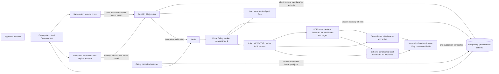

# RFQ architecture

Existing business routes, contracts, demo fixtures and analytics remain in place.
RFQ code is isolated in `apps/api/src/api/rfq`. Existing openpyxl, Pydantic,
FastAPI and psycopg are reused; the frontend reuses Better Auth, workspace membership,
the shell and shared buttons. It has no normal-operation fixture or fallback data.

SQL migrations exclusively own the separate `procurement` schema. Drizzle explicitly
owns public schema only. Existing runtime DDL is left alone. No startup auto-migration,
reset or destructive upgrade is introduced. See DATABASE_SCHEMA for version ownership.

PostgreSQL is the authoritative queue and state store; Redis is a delivery mechanism.
Accepting an upload does not perform extraction. The persisted job is recoverable even
if its first broker notification fails. One worker slot bounds OCR/model concurrency;
operators must maintain that bound when scaling. Chunked inference is sequential.

Deterministic mode reads explicit tables and key-value headers only. LLM mode uses
the actual provider for every nonempty document. Hybrid uses recognized procurement
tables deterministically and the local provider for documents without those tables.
Hybrid does not ask a model to reinterpret an already recognized partial table.
This trade-off avoids overwriting reliable cells but can miss poorly aligned rows.

Original files, parsed blocks/cache, immutable extraction snapshots, editable current
items and audit events have separate responsibilities. Approval locks the RFQ;
reprocessing an unapproved RFQ requires a reason and creates a fresh version while
preserving prior corrections. Approved requests require a new RFQ for subsequent work.

New dependencies: httpx; Celery with Redis; pypdf; pypdfium2; Pillow; defusedxml;
pycountry. Tesseract is the sole OCR runtime. pypdf/PDFium were chosen instead of
introducing an AGPL PDF dependency into the Apache-licensed project. Development
dependencies are pytest, pytest-asyncio, reportlab, Ruff and Playwright.
Exact Python and JS resolution is captured in uv.lock and pnpm-lock.yaml.

Core functionality is entirely local. There are no external provider fallbacks,
catalog search, embeddings, distributor actions, emails, purchases or quote submission.
