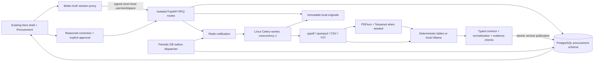

# OwnerPilot RFQ Phase 0 / Phase 1 implementation report

Date: 2026-11-19 (America/Phoenix). Branch: `feature/rfq-intelligence-phase-1`.

## A. Executive summary

Phase 0 and the Phase 1 local workflow are implemented and locally validated. The
Procurement workspace creates persisted, authenticated RFQs, uploads bounded local
documents, submits durable jobs, extracts typed data with deterministic parsers and
actual Ollama inference, exposes source evidence, accepts audited corrections and
locks an explicitly approved version. Phase 2 is not implemented.

Operational: PDF/CSV/XLSX/TXT; Linux Tesseract including mixed/scanned PDFs; real
qwen3.8:27b HTTP structured generation; PostgreSQL/pgvector; Redis/Celery; review,
concurrency control and approval; synthetic data and reproducible benchmarks.
No remaining missing-runtime blocker. Quality limitations remain: OCR identifiers,
partial tables and LLM evidence failures. Production load/hostile-file hardening and
broader real-world/model evaluation are not established by this local validation.

No existing application database was connected to or reset. All validation used
separate disposable databases. Nothing was pushed or externally deployed.

## B. Architecture and data flow

The backend rechecks workspace membership and role independently of the web proxy.
The database owns job state; Redis delivery failure cannot erase an accepted job.
Session advisory locks and unique run/job constraints prevent duplicate publication.
Run/items/current pointer/job completion/audit commit atomically. Corrections capture
before/after and reasons; RFQ revision protects stale tabs. Approval is immutable.

Hybrid uses recognized tables before inference; unstructured documents use the real
local provider. Its partial-table trade-off is documented. Source evidence is verified
against actual parser blocks, not blindly accepted model citations. All populated
unverified fields and critical missing fields must be reviewed/resolved before approval.
See ARCHITECTURE, DOCUMENT_PROCESSING, DATABASE_SCHEMA and SECURITY for exact boundaries.

## C. Repository changes

New backend package: `apps/api/src/api/rfq/` with configuration, versioned contracts,
storage, parser Protocol/implementations, validation, versioned prompt, async provider,
extraction/merging, middleware, authorization, repository, worker, routes, migrations
and evaluation generator/runner. Existing `demo_data.py` was not expanded or rewritten.

New frontend: `/procurement`, `procurement-workspace.tsx`, `rfq-api.ts`, authenticated
`/api/procurement/[...path]` proxy and workspace-membership listing. Contracts are in
`packages/contracts/src/rfq.ts`. Existing shell navigation and shared UI are reused.
Explicit RFQ button styles keep controls visible with this Tailwind workspace setup.

Infrastructure: RFQ Redis/worker/dispatcher overlay and a separate disposable validation
Compose file. API Docker now uses Python 3.14, the checked-in uv lock and Tesseract;
it also copies demo fixtures needed by the existing API. Docker ignores private env
and runtime files. uv module discovery was fixed. Drizzle now has explicit ownership
filters so public business schema push does not own Better Auth or procurement tables.
An installed-library auth migrator avoids a floating external CLI.

New database objects: `procurement.schema_migrations`, `rfqs`, `rfq_documents`,
`rfq_document_pages`, `rfq_processing_jobs`, `rfq_extraction_runs`, `rfq_line_items`,
`rfq_audit_events`. Evidence and reviews are typed JSON within runs/items/events,
avoiding duplicate evidence/review tables. Migrations are additive `0001_rfq.sql`
and `0002_integrity.sql`; existing business tables/migrations are unchanged.

19 RFQ API operations cover create/list/detail, upload/list/download, process/reprocess,
jobs/detail/cancel, line list/add/edit, header edit, evidence, approval, audit and health.
Typed request/response DTOs and common error responses are exposed in OpenAPI.
See API_REFERENCE for exact paths. Existing endpoints keep their paths/contracts.

Dependencies: httpx, Celery/Redis, pypdf, pypdfium2, Pillow, defusedxml, pycountry;
development pytest/pytest-asyncio/reportlab/Ruff and Playwright. Tesseract is the only
OCR runtime. No paid/cloud service, learned embedding or second schema owner added.
README, CHANGELOG, environment example and ignore files are updated. New documentation
is under `docs/rfq`; synthetic inputs/labels/manifest under `data/evaluation/rfq`.
The complete file inventory is [FILE_INVENTORY.txt](FILE_INVENTORY.txt).

## D. Validation

Baseline: frontend lint, typecheck, test and production build passed (three package
tasks each). Existing test scripts only typechecked. uv sync had a pre-existing package
discovery failure; the old API Docker Python version also contradicted pyproject.
Both are corrected. Docker Desktop was stopped and uv absent; safely started/installed.

Final recorded backend suite: **58 passed, 0 failed, 0 skipped** including a real Ollama
smoke test. The 57 non-model cases comprise 29 unit, 15 RFQ integration and 13 legacy
API regression cases. Four upstream/legacy deprecation warnings remain. Earlier
`-m 'not ollama'` runs deliberately deselected the real test; it was then run in the
complete suite. They are not represented as skipped runtime success.

Final browser suite: **4 passed, 0 failed, 0 skipped**. One test explicitly simulates
unavailable model health; the business E2E uses real auth, API, PostgreSQL and worker.
Frontend lint/typecheck/test/build and Python compile/RFQ Ruff/lock checks passed.
Screenshots [evidence](screenshots/evidence.png) and [approval](screenshots/approved.png)
were saved and visually inspected using synthetic data.

Security/recovery observations: missing/expired identities denied; cross-workspace
resources hidden; viewers cannot approve; stale changes return 409; invalid model
output cannot publish; publication exceptions roll back run/items; repeated deliveries
remain single-run; unavailable broker work stays in PostgreSQL; cancelled/stale work
cannot publish; approval blocks further edits/reprocessing. Simulated database failure
returns sanitized 503, with no connection details. Originals never become executable
web content. Review histories retain extracted and corrected values.

Real worker SIGKILL during a 20-page OCR task recovered on attempt 2. Three redeliveries
left **one run, 100 source-linked rows, revision 1**. See worker-restart.json. Both fresh
and representative schemas were tested, and repeated RFQ migrations preserved workspace
records. A legacy Drizzle push on a populated representative schema stopped at a truncate
prompt; nothing was truncated. Fresh Drizzle/auth/vector/RFQ setup subsequently passed.

Full commands, earlier failures and environment distinctions are in PHASE1_VALIDATION.
No full historical business UI matrix, production load or penetration test is claimed.

## E. Evaluation

Frozen dataset: **48 documents / 240 items**; held-out: 32 / 160. Deterministic ran all
32; LLM/hybrid used eight stratified held-out documents / 40 items. Six digital LLM
successes plus two post-fix OCR rechecks form the explicitly labeled final aggregate.
Earlier OCR failures remain in the initial JSON; no results were fabricated or hidden.

| Metric | Deterministic | LLM-assisted | Hybrid | Subset / target / outcome |
|---|---:|---:|---:|---|
| Exact MPN | 57.5% | 82.5% | 82.5% | Matched 8 docs; scans depress results |
| Exact manufacturer | 70% | 97.5% | 95% | Same 40 items |
| Exact quantity | 70% | 87.5% | 95% | Same 40 items; 95% digital target |
| Item precision | 100% | 100% | 100% | One-to-one matching |
| Item recall | 70% | 100% | 95% | Same 40 expected items |
| Item F1 | 82.35% | 100% | 97.44% | 90% target; baseline misses prose |
| Required completeness | 70% | 95.83% | 95% | 3 required fields × expected items |
| Validated payload rate | 100% | 100% | 100% | Typed final payloads / attempted docs |
| Unsupported proposed fields | 0% | 1.97% | 0% | Unverified values blocked for review |
| Stored evidence validity | 100% | 100% | 100% | Exact source occurrence, not OCR truth |
| Processing success | 100% | 100% | 100% | Final selected 8 docs |
| Median latency, seconds | 0.020 | 105.780 | 0.127 | Parsing + extraction, no queue/review |
| P95 latency, seconds | 0.444 | 116.527 | 106.450 | Nearest rank, small subset |

Clean deterministic tables (12 docs / 60 items): **98.33% MPN, 98.33% quantity,
99.16% F1**, passing 95/95/90 on that subset. Six digital hybrid documents (30 items):
**100/100/100%**. LLM-only quantity on those digital samples: **83.33%**, target missed
because quantity excerpts failed verification in one workbook. On two scanned/mixed
samples, exact MPN was **30% for all modes**; hybrid quantity/F1 were 80%/88.89%.
Full deterministic 32-document F1 was 77.39%. These outcomes limit broader acceptance.

Actual model: qwen3.8:27b, ~17 GB; temperature 0, context 8192 in comparative runs,
4096 output tokens, 180-second call timeout, one retry, extract_v1 prompt and parser
1.0. RTX 4090 Laptop 16376 MiB, driver 610.88, Windows/Docker. No invented utilization.
Token/load/inference timings and hashes are saved per call. Default context is now
16384 with input budgeting; recorded results retain actual earlier settings. See
EVALUATION for denominator definitions, timing breakdowns, omitted measurements and
reproduction. Full 32-document model coverage remains future evaluation work.

## F. Demonstration

Use WINDOWS_SETUP's disposable path; start PostgreSQL/Redis, apply auth/public/RFQ
schema, start Linux worker plus native API and web. Open `/procurement`, sign in,
create a workspace and RFQ, upload `data/evaluation/rfq/sources/rfq-04-00.csv`, start
Hybrid extraction, inspect an MPN's evidence, review/correct every line with a reason,
acknowledge human review and approve. Reload to see locked persisted approval.
Use `rfq-08-00.txt` for actual model extraction and `rfq-10-00.pdf` for OCR.
DEMO_RUNBOOK contains exact steps; WINDOWS_SETUP contains PowerShell/Docker commands.

## G. Existing functionality and data preservation

Existing route names/contracts and deterministic showcase services remain. No changes
were made to `demo_data.py`, old business fixtures, existing migrations or production
records. Legacy API smoke cases and frontend production build pass. Data ownership
filters and the separate procurement schema prevent RFQ migration ownership conflicts.
The pre-existing global unauthenticated demo APIs remain a documented legacy limitation;
they cannot read RFQ tables through these new routes. This is not a claim of full legacy
application multi-tenant security. Existing datetime/pytest-plugin warnings remain.

## H. Proposed Phase 2 — not implemented

1. Catalog import adapters with supplier/version/source provenance and normalized,
   distinct manufacturer/MPN/SKU identifiers; quarantine incomplete records.
2. Real local learned embedding provider with pinned model/dimension/version and
   reproducible indexing; do not relabel existing hash embeddings as semantic vectors.
3. Exact manufacturer+MPN candidates, PostgreSQL/pgvector vector retrieval and BM25
   lexical candidates, with workspace/catalog filtering.
4. Hybrid fusion and local reranker with inspectable evidence; conservative product
   deduplication retaining variants, pack sizes and conflicting specifications.
5. Held-out retrieval relevance labels and Recall@K/MRR/nDCG, exact-match correctness,
   dedup precision and latency/resource benchmarks against lexical/vector baselines.

No distributor purchasing, automated supplier communication or quote submission.
