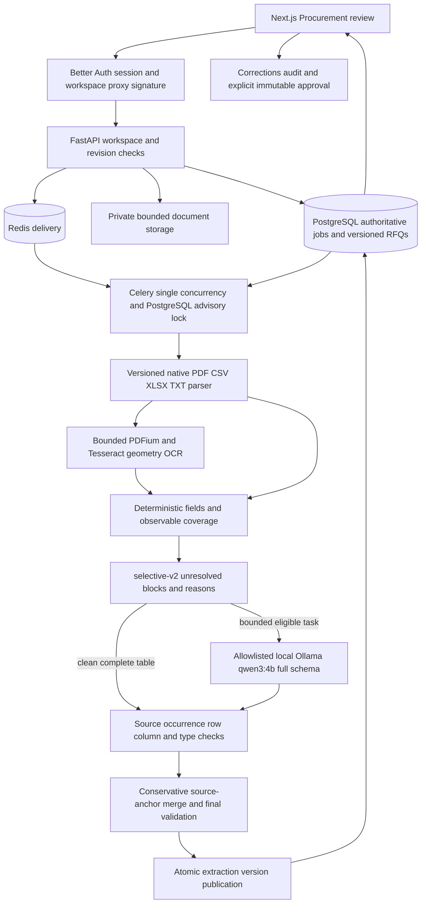

# Phase 1.1 architecture

The existing authenticated RFQ workflow remains the application boundary. New policies, OCR metadata and evidence fields are additive. Legacy extraction is an explicit version, not a reinterpretation of historical records.

`parsers.py` chooses native extraction or OCR and generates real source blocks. `ocr.py` owns image limits, preprocessing, TSV geometry and alternatives. `association.py` separates occurrence from structural checks. `selective.py` owns coverage/routing/merging; `provider.py` owns local inference and closed output validation. `worker.py` snapshots trusted job configuration, checks cancellation/revision, serializes publication and emits summaries. The repository layer keeps durable versioned data and authorization behavior.

Policy identifiers: phase1 delegates the frozen source snapshot; selective-v2/2.0 uses source-association/2.0 and parser1.1. OCR configuration is tesseract-geometry/2.1. New jobs default to selective-v2; migration0003 assigns existing jobs phase1/legacy-v1. Context-local configuration prevents one job's snapshot from contaminating another. Historical evidence defaults to unknown structural association rather than fabricated verification.

The selected runtime uses enhanced-v2 at300DPI, qwen3:4b full extract_v1, context8192/output4096 and no cascade. Native structured documents retain deterministic fast paths. Experimental compact prompts2/3 remain versioned and reproducible but are not selected. Old prompts and migrations are unchanged.

Trade-offs: deterministic extraction is fast and reliable on measured clean layouts; OCR geometry helps row recovery but recognition still fails ambiguous identifiers. The small model is faster on development prose, but held-out repair and generalization are poor. Structural checks reduce unsupported acceptance while requiring more review. Keep human approval and the original phase1 policy available; a fast empty response is a quality failure.

The separate demonstration services use ports3011/8011/6381 and a disposable database on55433. The pre-existing3000/8000/6380 services are untouched. No catalog, embedding, lexical retrieval, distributor integration or quotation agent is introduced.
