# OwnerPilot Phase 1.1 final implementation report

## A. Executive summary

Phase1.1 is implemented and locally functionally validated with unmet performance targets. Changes add configurable geometry-aware OCR, selective source routing, conservative evidence association/merging, measured local-model configurations, an independent frozen synthetic set, stronger one-to-one evaluation, safer migration reconciliation and review UI. Existing business functionality, auth, immutable approvals, released migrations and128 historical artifacts are preserved.

All103 backend tests pass, including real Ollama and legacy OwnerPilot API regressions. Six browser scenarios cover the four original flows, quality fixtures and actual Linux OCR. All six final evaluation configurations completed32/32 documents each,192 attempts with no failed jobs/skips. Real worker SIGKILL recovery retained one publication after repeated delivery. A populated synthetic database reconciliation preserved225 rows in27 tables, including auth/history and3 approved RFQs.

Quality remains poor outside clean layouts. Selected hybrid v1 MPN61.25%, quantity53.75%, F178.87%; independent v2 MPN48.75%, quantity60.62%, F171.68%. Independent scanned MPN accuracy is0/40. Real partial routing invoked the model but did not populate its added row. These failures prevent an unattended extraction-readiness claim. Human review remains mandatory. No deployment, GitHub push or Phase2 implementation was performed.

## B. Architecture

```mermaid
flowchart LR
  Review[Next.js session and review] --> Proxy[Signed workspace proxy]
  Proxy --> API[FastAPI revision and role checks]
  API --> Jobs[(PostgreSQL jobs and versions)]
  API --> Redis[Redis delivery]
  Redis --> Worker[Locked single-concurrency Celery]
  Worker --> Parse[Native parse or bounded geometry OCR]
  Parse --> Deterministic[Deterministic fields and source coverage]
  Deterministic --> Route[Selective unresolved source blocks]
  Route --> Model[Local 4B full-schema model when eligible]
  Model --> Verify[Occurrence row column type checks]
  Route --> Verify
  Verify --> Merge[Retain reliable values and conflicts]
  Merge --> Atomic[Atomic publication]
  Atomic --> Jobs
  Jobs --> Review
```

Explicit phase1 and selective-v2 policies coexist; existing jobs default historically through additive migration0003. OCR caches include engine/config identity. Source occurrence and structural association are distinct from human confirmation. Model configuration is persisted per job; no hidden cascade or external model tools. [ARCHITECTURE.md](ARCHITECTURE.md), [HYBRID_EXTRACTION_DESIGN.md](HYBRID_EXTRACTION_DESIGN.md) and [EVIDENCE_VALIDATION.md](EVIDENCE_VALIDATION.md) describe responsibilities and limitations.

## C. OCR improvements and failures

Twelve development scans/60 items, with native-text dev fixtures excluded below. Initial failed variants are retained. Identifier CER includes full deletions for undetected rows; it is not full-page OCR CER/WER.

| Strategy | Exact MPN | Exact quantity | Identifier CER | Median/P95 OCR | Dataset |
|---|---|---|---|---|---|
| Original OCR |0/60|0/60|100.00%|0.349/0.437s|v2 dev scans |
| Initial enhanced |0/60|0/60|100.00%|0.604/0.789s|same |
| Enhanced with ruled-grid removal |0/60|36/60|45.26%|0.549/0.686s|same |
| Combined with targeted MPN crops |0/60|36/60|45.26%|0.828/0.993s|same |

Selected enhanced-v2 improves measured row recovery and identifier character distance, but exact MPN recognition did not improve on these dev scans. PSM7 targeted alternatives add cost without exact-match benefit. Original characters, actual word boxes/confidence and disagreements remain auditable; no O/0 substitutions. Mild deskew is bounded±5degrees;90/180-degree orientation correction remains unavailable. Low-resolution/compressed ambiguous identifiers remain the principal failure. Full matrix, synthetic error examples and pass limits: [OCR_EXPERIMENTS.md](OCR_EXPERIMENTS.md).

## D. Model comparison and selection

All use Q4_K_M, full extract_v1 schema, temperature0, context8192/output4096. The4B/8B comparison uses the same two dev prose docs/10 items;27B full covers the first doc only. Exact digests are retained in model summary/resources; prefixes below identify them without implying mutable tags are sufficient provenance.

| Model / digest prefix | MPN | Qty | F1 | Validated payload | Median/P95 | Cold/warm | Peak observed GPU/system RAM |
|---|---|---|---|---|---|---|---|
| qwen3:4b /359d7dd4bcda |10/10|10/10|100%|2/2|28.986/30.223s|30.223/27.748s|4631MiB/26.16GiB |
| qwen3:8b /500a1f067a9f |10/10|10/10|100%|2/2|42.498/43.550s|43.550/41.447s|6971MiB/22.60GiB |
| qwen3.8:27b /aaee06c39dcf |5/5|5/5|100%|1/1|111.618/111.618s|111.618/unmeasured|15131MiB/26.68GiB |

4B was selected from development results for lower latency at matching measured quality. Compact prompts2/3 were rejected: exact MPN accuracy0/10 across candidates despite valid output. The tiny prose selection sample did not predict broad held-out quality. No measured evidence justified a larger-model cascade. Actual Ollama ps showed100% GPU for smaller full models and27% CPU/73% GPU for27B at8192 context; no offload inference was made solely from checkpoint size. RAM figures are whole-system sampled peaks. Details and all rejected results: [MODEL_BENCHMARKS.md](MODEL_BENCHMARKS.md).

## E. Extraction ablations

Post-selection authored routing diagnostics: two documents/three expected items, same small model/schema, native TXT and no OCR. This is a mechanism check, not independent quality evidence or further tuning.

| Configuration | MPN | Qty | F1 | Model calls | P95 |
|---|---|---|---|---|---|
| phase1 deterministic |2/3|2/3|80.00%|0|0.041s |
| phase1 hybrid |2/3|2/3|80.00%|0|0.024s |
| selective deterministic |2/3|2/3|80.00%|0|0.002s |
| selective hybrid |2/3|2/3|66.67%|1|2.051s |

Selective processing no longer silently bypasses a partial document, but the real model's empty extra row lowers precision. Supported authored repair proposals pass isolated merge tests; they are not model-quality evidence. OCR/geometry and association contributions are coupled in the OCR matrix. Model sizes are compared within identical schema/prompt groups; compact/full prompt experiments are separate. No unmeasured stand-alone association improvement or cascade benefit is claimed. See [EXTRACTION_ABLATIONS.md](EXTRACTION_ABLATIONS.md).

## F. Final evaluation

Fresh homogeneous selected hybrid executions; old v1-compatible rescoring and LLM/deterministic comparisons are separate in [EVALUATION_RESULTS.md](EVALUATION_RESULTS.md). Source/config hashes and sample IDs are in each JSON/config/journal. No final sample was used to revise selection. Every row below has0 failed jobs/0 skips.

| Set/subset | Docs/items | MPN correct | Qty correct | Item F1 | P95 |
|---|---|---|---|---|---|
| v1 matched eight |8/40|24/40(60.00%)|23/40(57.50%)|78.87%|2.987s |
| v1 all |32/160|98/160(61.25%)|86/160(53.75%)|78.87%|2.987s |
| v2 all independent |32/160|78/160(48.75%)|97/160(60.62%)|71.68%|5.270s |
| v1 clean |16/80|79/80(98.75%)|75/80(93.75%)|100.00%|4.662s |
| v2 clean |16/80|78/80(97.50%)|79/80(98.75%)|100.00%|5.599s |
| v1 scanned/mixed |8/40|19/40(47.50%)|11/40(27.50%)|84.21%|2.987s |
| v2 scanned/mixed |8/40|0/40|18/40(45.00%)|56.34%|3.043s |
| v1 adversarial |4/20|0/20|0/20|0.00%|1.912s |
| v2 adversarial |4/20|0/20|0/20|0.00%|2.206s |

The fresh original27B Phase1 hybrid matched-eight run reproduced82.5% MPN,95% quantity,F197.44%,P95117.643s. New P95 is97.46% lower, with substantially worse quality. The elapsed-time target alone is met; this is not equivalent-quality speedup. The older published106.450s P95 is a distinct mixed-origin historical reference. Stronger matching changes F1 definitions; compatible rescoring is supplied rather than silently comparing incompatible values.

Unsupported accepted literal fields are0/701 in v1 hybrid and0/669 in v2 hybrid, while erroneous item fields, OCR errors and failed recovery remain nonzero. Automatic structural verification is not document truth. Full denominators, null measurements, observable row/column labels, duplicate-warning semantics and latency failure handling are in [EVALUATION_METHODOLOGY.md](EVALUATION_METHODOLOGY.md). Most aspirational quality gates fail; results/final/performance-gates.json retains every pass/fail.

## G. Reliability and regression validation

Original58 backend tests are preserved;45 new cases bring the final count to103,0 failures/skips. Baseline non-model run was57+1 deliberate model deselection; genuine baseline inference was measured separately. Final full suite includes real Ollama. Original four browser scenarios remain, with two added quality/OCR scenarios. Type/lint/build/compile/lock checks pass; repository pnpm test performs type-level checks.

Real SIGKILL during20-page OCR recovered on attempt2, published100 items once and retained one run after3 repeated deliveries. Cancellation during a provider call and before publication prevents publication in explicit integration fixtures; GPU cancellation is not claimed. Actual cross-workspace evidence/download return404; pre-review approval422 and post-approval reprocess409. No business/auth boundary was weakened.

Fresh and representative migration tests pass. Equivalent constraint names reconcile safely; a populated copy with225 rows,27 tables and3 approvals retains identical hashes. Forced rename failure rolls back all schema renames and data; repeat applies0 changes. No application DB was truncated/reset, no released migrations edited. Preservation check:128 historical files changed[]. See [RELIABILITY_VALIDATION.md](RELIABILITY_VALIDATION.md), [MIGRATION_COMPATIBILITY.md](MIGRATION_COMPATIBILITY.md) and [PHASE1_1_VALIDATION.md](PHASE1_1_VALIDATION.md) for commands, previous failures and measured limits.

## H. Demonstration

Use the isolated production app at http://localhost:3011/procurement with API8011, worker/Redis6381 and disposable PostgreSQL55433. [WINDOWS_SETUP.md](WINDOWS_SETUP.md) gives exact setup, model, OCR, dataset, full evaluation/resume, regression, migration and crash-check commands.

Clean XLSX hybrid processing shows calls0. The v2 dev scanned grid shows actual source coordinates/raw OCR and review warnings. The partial diagnostic demonstrates an attempted selective call and unresolved result, not fabricated repair success. Inspect source occurrence separately from association, correct fields with a reason, review active rows and approve; refresh to verify the lock. Reprocessing an unapproved RFQ creates a distinct extraction version. The restart script provides the guarded recovery demo.

Actual screenshots: [evidence](results/final/screenshots/evidence.png), [approved](results/final/screenshots/approved.png), [Linux OCR](results/final/screenshots/ocr-actual.png). OCR-disagreement fixture assertions are explicitly UI tests and do not claim measured recognition performance.

## I. Resume-ready evidence

- Built versioned local RFQ extraction with source-linked selective routing, bounded geometry OCR, workspace authorization and immutable human-reviewed approvals; validated103 backend cases and6 browser scenarios.
- Benchmarked4B/8B/27B local models with exact digests and cold/warm telemetry, then completed192 synthetic document/configuration evaluations across fixed v1 and independent v2 splits, reporting unmet quality targets explicitly.
- Verified PostgreSQL/Celery crash recovery on attempt2 with one publication after repeated delivery, and reconciled16 equivalent schema constraint names while preserving225 synthetic rows,3 approvals and128 historical artifacts.

## J. Phase 2 proposal only

Approved RFQ output provides a versioned, reviewed query boundary for later catalog work. A future milestone can ingest licensed product catalogs with provenance, immutable manufacturer/MPN keys and product-variant attributes; exact matching should precede learned embeddings. PostgreSQL/pgvector semantic candidates and BM25 lexical candidates can be fused, deduplicated by catalog identity and reranked with explicit compatibility checks for variants, pack quantities and units. Evaluate retrieval recall/ranking independently with frozen labels and abstention for incompatible or ambiguous matches.

None of those Phase2 capabilities is implemented here. Readiness recommendation: keep a supervised local demonstration; prioritize OCR identifier recovery, empty model-output handling and stronger independent layout coverage before relying on extraction as an automated catalog query. Phase2 design can proceed separately, but existing quality failures must remain visible and approved human corrections must anchor any downstream retrieval.
