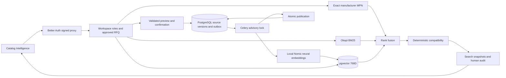

# Architecture

Catalog tables are separate from inventory. Tenant/version SQL restrictions apply before fusion. Source/query/candidate snapshots preserve historical explanations after supersession. Offline ground-truth evaluation has no production endpoint and is restricted to a named disposable DB.
