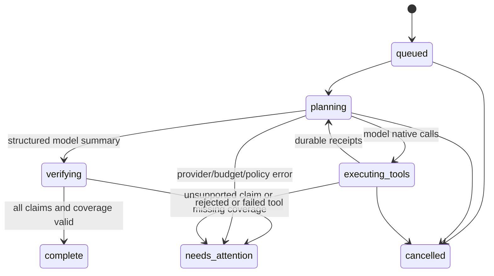

# Agent design

The production provider uses Ollama `/api/chat` native function calls. Existing `qwen3:8b` advertises `completion`, `tools` and `thinking`; tag and digest are read from the actual runtime. Final benchmark digest is `500a1f067a9f782620b40bee6f7b0c89e17ae61f686b92c24933e4ca4b2b8b41`. Configurable local endpoint/tag: `PROCUREMENT_AGENT_URL`, `PROCUREMENT_AGENT_MODEL`. No cloud fallback or auto-pull.

Protocol reference: [Ollama native tool calling](https://docs.ollama.com/capabilities/tool-calling) and [chat API](https://docs.ollama.com/api/chat). Capability and execution claims here come from the actual local smoke/benchmark artifacts.

Final prompt `procurement-native/5`, registry `procurement-tools/2`, temperature 0, context 8,192, output 1,600 tokens, 65,536-byte response cap. Model identity is checked before and after every call. The request-time prompt/tool version is pinned; resumed work fails safely after a version change.

At most four model turns, eight tool requests and two equivalent name/argument calls. Third equivalent calls produce rejected receipts. One local model execution at a time; three durable delivery attempts. Overall wall time is 240 seconds from admission, including queue delay. Provider timeout 60 seconds, database statement timeout 10 seconds, lexical reads local; vector retrieval retains its bounded embedding timeout. Tool result cap 20 KB; argument cap 4 KB; prompt messages cap 24 KB. Large supported RFQs can still exceed the model evidence/context budget and require attention; the 100-line domain limit does not promise 100-line autonomous research completion.

The model chooses tools; a deterministic hardcoded tool sequence is not used in production. Once actual selection/offer tool coverage exists for every line, or the planning budget ends, the backend requests a structured final summary. A bounded receipt-derived citation inventory helps the model copy valid references. This does not authorize new facts: an independent verifier checks receipt existence/status, exact pointer traversal and scalar type/value equality. Pointers start at the model-visible `/data` envelope.

Native requests and sanitized messages are committed before execution. Each tool receipt has ordinal, schema, arguments hash, policy/status, result, duration and source context. Recovery reuses existing receipt ordinals and executes only unfinished read requests. Model calls interrupted before their request is stored may be repeated; pre-incremented model-turn counters prevent unbounded recovery.

No thinking fields or unrestricted model prose are persisted. Tool-call message content is blank. Final storage contains verified claim records and concise fixed limitations only. Invalid summaries become attention states with sanitized categories, not fabricated success.
