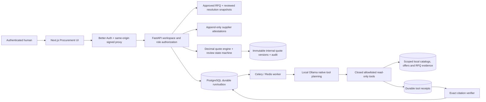

# Phase 3 architecture

The browser carries a real Better Auth session. The web proxy resolves workspace membership, requires same-origin mutations and signs method/path/workspace/user claims. FastAPI independently verifies the signature and current membership. Model arguments cannot override this trusted context.

Agent tools read bounded snapshots or authorized local retrieval. They cannot write RFQs, catalogs, resolutions, offers, quotes or approvals. Quote creation and human approval use separate authenticated service methods and never accept a model-calculated amount.

PostgreSQL is authoritative for jobs, receipts, selected versions and quote history. Redis delivers notifications; the database dispatcher recovers missed messages. A session advisory lock serializes local-model runs, releases on worker death and prevents concurrent duplicate execution. One active run per RFQ and two queued/active runs per workspace bound admission.

New additive migrations 0005/0006 introduce seven tables and evidence/quote protection triggers. Released migrations 0001–0004 are unchanged. Published products and approved RFQs are read-only to this domain.
