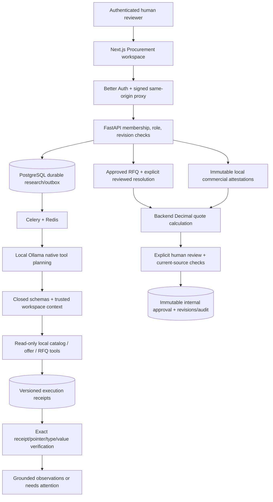

# OwnerPilot Phase 3 — final implementation report

Local branch: `feature/rfq-intelligence-phase-3`, based on verified Phase 2 merge `dd3bd99c6fede176d987aab41b1478ea3ba41ca6`. Validation date: November 21, 2026, America/Phoenix. Changes remain local; no push/deployment or Phase 4 implementation.

## A. Executive summary

Implemented the Phase 3 workflow end to end: authoritative reviewed product resolutions; versioned source-labeled supplier attestations; actual local LLM native tool research; bounded authorized read tools and durable receipts; exact citation verification; Decimal quote preparation; human changes requested/review/approval; immutable approved versions, source snapshots and audit history; authenticated responsive UI and API integration.

**Functional implementation is complete for the documented local scope. Full research-quality acceptance is not achieved.** Final real-model research completed 6/10 scenarios after verification, including 4/8 held-out, below the aspirational 95%. Four malformed price-string claims were rejected. No unsupported claim was accepted and model output never controlled financial amounts or approval.

The full backend suite has **260 passing tests and one retained strict expected failure** for a diagnosed frozen financial oracle defect. All original 145 cases remain included: 115 additional passes and one added expected-failure case. The browser suite has **11 passing scenarios**, retaining all original seven and adding four Phase 3 cases. There are 34 standalone financial cases and 200 templated batch line amounts; one frozen batch total is independently known to be mislabeled and is not reported as passing.

The real SIGKILL experiment recovered durably and preserved receipts, but ended needing attention because the original turn budget no longer yielded full research coverage. Actual HTTP capability/outage and in-flight cancellation probes passed. These results demonstrate safe local failure behavior, not production readiness, live supplier verification or universally accurate procurement research. Phase 1.1 OCR weaknesses remain unresolved.

## B. Architecture and trust boundaries

The model cannot select the authenticated workspace, change RFQs/catalogs/offers, create quote approvals or invoke external actions. Tools accept only bounded closed arguments. The quote engine accepts human-selected immutable offer IDs and declared financial policies; model amounts are never authoritative.

Research moves through queued, planning, executing_tools, verifying and complete/needs_attention/failed/cancelled. Requests/receipts are durably saved before proceeding; delivery recovery reuses completed receipt ordinals. Limits: four model turns, eight tool calls, two equivalent repeats, three delivery attempts, one local inference at a time and 240 seconds total wall time. Model digest, prompt and schema versions are pinned. Cancellation gates publication. Hidden reasoning is discarded.

Migrations 0005/0006 add seven tables. Evidence, quote history and audit rows are append-only; approved quote aggregates are protected by a PostgreSQL update/delete trigger. New drafts link to prior final quotes through audit lineage without mutating the old approval. Non-vector retrieval no longer contacts the embedding provider; vector/hybrid failures remain explicit, with no silent substitute for the requested rank policy.

See ARCHITECTURE, AGENT_DESIGN, TOOL_REGISTRY, AGENT_SECURITY, QUOTE_SCHEMA and HUMAN_APPROVAL for implementation details and API routes.

## C. Actual tool-using agent results

Installed qwen3:8b, digest `500a1f067a9f782620b40bee6f7b0c89e17ae61f686b92c24933e4ca4b2b8b41`, prompt `procurement-native/5`, tools `procurement-tools/2`. No model weights were downloaded. The earlier qwen3:4b and 8B development failures are preserved separately; no held-out prompt retuning followed the final frozen run.

| Metric | Deterministic baseline | Tool-using agent, offline schema-only counter | Agent + verification |
|---|---:|---:|---:|
| Research assistance completed | 10/10 source listings | 10/10 schema-valid candidates | 6/10 verified summaries |
| Correct backend-authorized tool execution | N/A | 30/30 | 30/30 |
| Unsupported scalar claims | 0 generated | 4/160 candidates | 0/80 accepted |
| Evidence validity | Direct source data | 156/160 claims (97.5%) | 80/80 accepted (100%) |
| Median latency | 0.055 ms source listing | 16.787 s, paired trace | 16.787 s |
| P95 latency | 0.065 ms source listing | 18.824 s, paired trace | 18.824 s |

There were 40 actual model turns. Every final native tool request had valid authorized arguments and succeeded; the model used approved-RFQ, reviewed-selection and supplier-offer reads. This does not establish that its investigative choices were optimal or that it used every optional tool. Its four failed summaries returned `10},{` in place of source price `10`; exact verification blocked the entire summary. No fabricated availability was accepted. The prompt-injection scenario invoked no forbidden action.

The no-verifier column is a counter on the same actual trace, not a deployed unsafe mode. JSON validity alone is not correctness. The deterministic listing excludes snapshot/database/network setup and performs a narrower task, so its latency is not a model speedup comparison. A separate paired deterministic quote-preparation baseline used the identical offers and predeclared human policy: 4/10 complete, six correctly incomplete. Research did not invent missing information to increase quote completeness.

The corpus has 64 records: 34 standalone commercial cases, 20 templated batch scenarios and 10 native scenarios. Only ten involve real model research. The 200 batch quote lines are correlated arithmetic families, not 200 independent agent tasks. Native evaluation has two development and eight held-out cases; it does not have a large independent validation split. Tokens/peak resource use were not measured reliably. Raw counts/receipts are in `results/measured-summary.json`, `agent/*.json` and EVALUATION_RESULTS.

## D. Quote correctness and approval policy

Backend `quote-decimal/1` uses bounded Decimal inputs and ROUND_HALF_UP currency rounding. It distinguishes markup and margin, explicit discounts, each/pack pricing, MOQ, quantity breaks, purchased vs billed quantities, surplus allocation, shipping and tax basis. It supports USD/EUR/GBP/INR/JPY and blocks unverified conversion or unsupported RFQ units. Optional attested stock is checked against purchased quantity. Unknown values remain null and prevent a complete total.

Two units at USD 10 with 20% markup total USD 24 before shipping/tax. Shipping 5 plus tax 10% on subtotal + shipping yields USD 31.90. A reviewed shipping change to zero yields USD 26.40. The actual browser workflow recalculated, requested changes, resubmitted and approved this version, then reloaded it immutably.

All 34 standalone frozen cases match their authored expected outcomes. All 200 batch line amounts match. Nineteen of twenty batch total labels match; the remaining frozen JPY label wrongly floors tax: line subtotal 845, tax 84.5 rounded to 85, correct total 930, original expected 929. The original dataset/hash is preserved; a strict expected-failure comparison and a separate passing manual audit document this defect. **The 100% frozen-total-label objective is therefore not claimed.**

Submission/approval recomputes using current UTC validity and checks RFQ revision, current review digest/resolution, published catalog, unchanged attestation set, offer freshness/availability, policy completeness and human review attestation. Missing prices, mixed currency, stale sources, unresolved substitutions and surplus/conversion issues block approval. Editor/viewer denials, duplicate approvals, actual concurrent approval attempts and edits after approval are tested. Internal approvals do not imply supplier acceptance or quote delivery.

## E. Reliability, regressions and preservation

Original baseline: 145 backend tests and seven browser scenarios passed after repairing verified Windows checkout line-ending damage. Final suite: 260 backend passes plus one known oracle-label expected failure; 11 browser passes. Original tests were retained unchanged.

The isolated worker was SIGKILLed during native planning turn 2 after one actual tool receipt. Restart/outbox recovery took 89.35 seconds and used attempt 2. The existing receipt ID/result survived; ordinals remained unique; actual terminal redelivery left receipts unchanged. Final state was needs_attention for missing offer coverage within the original budget. Zero quote versions/approvals were produced by research. This verifies safe recovery and abstention, not completed-research recovery.

Three actual HTTP probes (absent model, installed model without tools, unreachable local endpoint) each rejected research with 503 while deterministic calculation still returned USD 24.00. Actual in-flight cancellation during turn 1 persisted cancelled, added no receipts and published no summary. Protocol fixtures separately cover malformed JSON, timeouts, result sizes, rejected tools/repeats, service failures, retry caps and scope checks; their counts are not native-model successes.

Populated migration validation preserved all 27 original table hashes/counts while adding seven tables; repeat migration passed. The synthetic workspace/approved RFQ sentinel and existing schema remained unchanged. Released migrations were not edited. Phase 3 services use new isolated demo/test DBs; no existing database was reset. The standard Docker worker overlay was configuration-validated; the measured workflow used the isolated validation stack.

The 434-file preservation baseline yields 362 byte-identical files and 72 manifest-verified checkout repairs normalizing to the same Git payload objects, with zero unexpected changes. Historical manifests/labels/reports remain unchanged. Initial corruption/failure artifacts and failed development attempts are retained. See PHASE3_VALIDATION and RELIABILITY_VALIDATION for commands and exact artifacts.

## F. Actual frontend demonstration

All screenshots use fictional data and the actual authenticated local app:

- [Research workspace](screenshots/research-workspace.png): approved line, resolution, commercial sources, research and internal quote.
- [Native tool timeline](screenshots/native-research.png): real model-generated reads, durable receipt IDs and verified observations/attention state.
- [Supplier comparison](screenshots/supplier-comparison.png): attested source/date/price provenance and same-basis comparison.
- [Human review](screenshots/human-review.png): under-review quote with explicit reviewer controls.
- [Approved internal quote](screenshots/approved-quote.png): immutable final version, Decimal amounts and revision history.
- [Calculation breakdown](screenshots/calculation-breakdown.png): requested/purchased/billable units, unit price, discount and price evidence.
- [Audit history](screenshots/audit-history.png): persisted human decisions and revisions.
- [Mobile quote](screenshots/mobile-quote.png): 390-pixel viewport with no page overflow.

Playwright also verifies expired offers/unselected products stay incomplete and a real editor request is rejected by the signed browser proxy/backend. Outage UI fixtures are explicitly labeled; they are not model integration evidence. Reproduce using WINDOWS_SETUP and DEMO_RUNBOOK.

## G. Resume evidence

- Built a local procurement research agent with ten closed read-only tools, durable PostgreSQL/Celery receipts and independent citation verification; evaluated 30 authorized native tool calls across ten synthetic scenarios, rejecting every unsupported candidate claim.
- Implemented Decimal quotation preparation with MOQ/pack/quantity-break rules, versioned supplier attestations, human review and immutable approvals; validated 200 synthetic line amounts and documented a preserved independent-oracle defect.
- Extended an authenticated Next.js/FastAPI procurement workflow with 260 passing backend tests and 11 passing browser scenarios; verified real SIGKILL receipt preservation, in-flight cancellation and model-outage calculation continuity.

These bullets do not claim autonomous purchasing, production deployment, real distributor integrations or 95% research completion.

## H. Phase 4 proposal — Production AI Infrastructure and Deployment Hardening

Proposal only; no Phase 4 implementation was started.

1. Resolve summary reliability using a new frozen native evaluation version with independent development/validation/test sets, more products/suppliers and unambiguous price/citation contracts. Keep final Phase 3 results immutable. Correct the known financial oracle only in a reviewed new dataset version with explicit errata.
2. Separate inference admission from workspace jobs, benchmark model batching/concurrency/context limits, and define measurable latency/queue SLOs. Pin model artifacts and container releases before considering scalable local serving.
3. Add centralized redacted metrics/tracing for queue age, attempts, tool denials, unsupported claims, cancellation latency and source-drift failures. Establish alerting and evaluated release gates; do not log hidden reasoning or raw private documents.
4. Design queue/worker scaling, rate limits, resource quotas and shutdown behavior. Evaluate container orchestration/Kubernetes only after workload/load tests justify it; preserve idempotency and database publication checks across replicas.
5. Define retention, evidence access, encryption, least-privilege DB roles, authenticated storage, backups/restore and disaster-recovery drills. Add segregation-of-duties/approver assignment and stronger quote signing if business policy requires them.
6. Establish production evaluation monitoring and representative load/failure/security campaigns. Supplier integrations require separately authorized credentials, terms, licensed schemas, timestamp/availability semantics and audit policy. No distributor scraping, automatic email, ordering or payment is authorized by this proposal.
