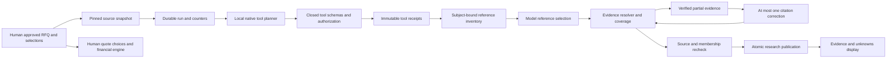

# Phase 3.1 architecture

The backend owns business values. Ollama chooses read-only tools and citation groups. A single resolver validates successful stored receipts and materializes exact scalars with entity provenance. There is no model-generated commercial narrative.

`provider.py` and its byte-identical `legacy_provider.py` copy retain prompt 5 behavior. `runner.run_agent` dispatches by pinned claim schema; old runs use the original runner body. New runs use `provider_v2.py`, `runner_v2.py`, and `evidence.py`. Unknown pinned protocols require attention. Schema validity alone cannot publish research.

Migration 0007 adds finalization checkpoints, a repair counter, diagnostics, immutable finalization records and model-call telemetry. Successful and rejected tool receipts become append-only. No tool registry capability, quote calculation, quote approval, extraction or catalog selection authority was added.

The new UI renders backend fields, explicit unknowns, line coverage, source associations and recovery information. A verified staged result remains unpublished until the durable run state is `complete`. Research results have no authority over internal quote approval.

Limitations: the evidence resolver currently materializes approved RFQ fields, reviewed selection states/identities, reviewed product identities and typed user-attested offer fields. Other allowlisted tools remain visible as receipts; arbitrary text from those tools is not automatically classified as a commercial scalar. Research covers the frozen approved snapshot, not the public web or a live supplier feed.
